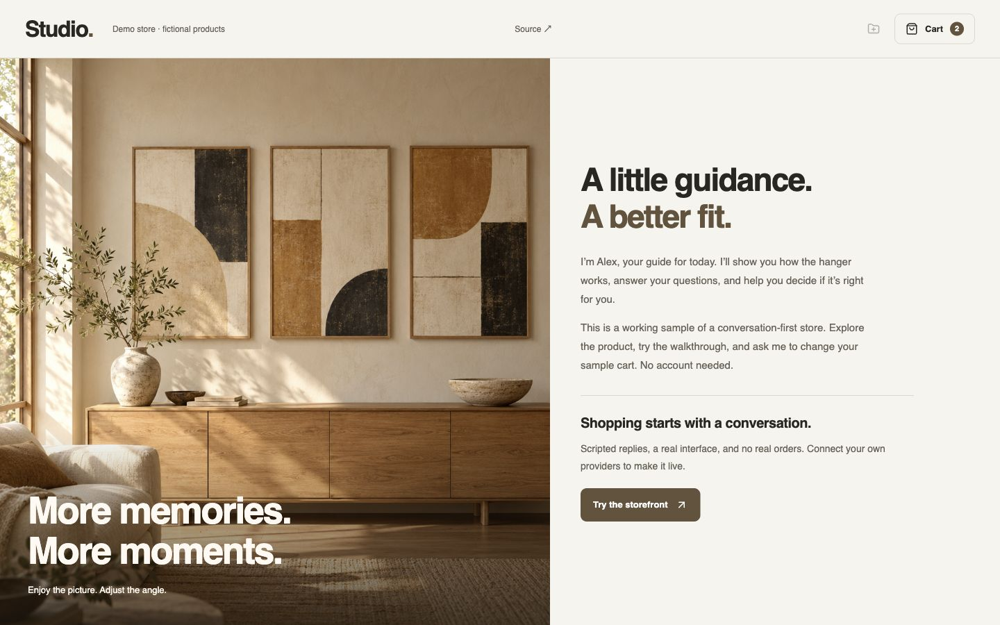

<p align="center"><strong>AGENTIC STOREFRONT</strong></p>
<h1 align="center">The conversation is the storefront.</h1>
<p align="center">A voice-and-chat shopping experience where the agent shows the product, answers questions, and manages the cart.</p>
<p align="center"><a href="https://github.com/leviseyes/agentic-storefront/actions/workflows/ci.yml"></a>  </p>



Most store assistants sit in a chat bubble. This starter gives the agent the page: product views, a walkthrough, photo concepts, and a cart appear beside an uninterrupted conversation.

**Try it without keys.** The included fictional merchant, Studio, uses scripted replies and a local sample cart. No AI account, Shopify account, payment, or Cloudflare login is needed to run the default demo.

```sh
git clone https://github.com/leviseyes/agentic-storefront.git
cd agentic-storefront
npm ci
npm run dev
```

Open **http://localhost:3000** with Node **24 or 26**. The first start creates a local SQLite database through Wrangler. Your data stays in the ignored `.wrangler/` directory. Supported development platforms are those supported by Wrangler; CI runs on Linux and the initial demo was checked on macOS.

Try these messages:

- **“Show me the 3D model”** → inspect it, turn it around, separate the parts.
- **“Show me how it works”** → open the walkthrough; the agent follows up when it closes.
- **“Add two to my cart”**, **“make it five”**, **“remove one”** → update the cart in the left panel.
- **“Empty my cart”** → remove the items. Checkout always stays a harmless local preview in demo mode.

## What’s here

| Capability | Keyless demo | With your own services |
| --- | --- | --- |
| Suggested replies, typed input, conversation history | Included; scripted responses | OpenAI structured responses |
| Agent-selected product views | Original procedural 3D model + illustrations | Replace with your product assets |
| Centered walkthrough + follow-up | Local authored sequence | Optional merchant YouTube video |
| Cart add / remove / set quantity | Local sample cart | Shopify Storefront API |
| Checkout | Explicit demo completion screen | Allowlisted Shopify checkout handoff |
| Natural voice and interruption | Disabled | xAI realtime voice; ElevenLabs speech fallback |
| Photo uploads and wall concepts | Disabled | OpenAI image editing + private R2 storage |

**This is a focused single-product starter, not a finished commerce platform.** It supports one configured variant, US market context, and quantities from 0–20. Payments, tax, shipping options, discounts and orders belong to Shopify checkout. There is no order-management or Admin API access in the customer-facing app.

## Make it your store

1. Edit [`storefront.config.js`](storefront.config.js) for the public identity, guide name and demo price.
2. Replace the fictional knowledge in [`client/shared/product-knowledge.js`](client/shared/product-knowledge.js), the sample conversation shortcuts in [`server/wall-conversation.mjs`](server/wall-conversation.mjs), and the product visuals. Verify every product and policy claim. The starter is deliberately tailored to one illustrative wall-mount product.
3. Copy `.env.example` to **`.dev.vars`** for local credentials. Keep it private. The demo works without this file.
4. Add only the providers you need. Keep `COMMERCE_MODE=demo` while testing AI and voice. Switch to Shopify deliberately after following the [configuration guide](docs/configuration.md).

The UI hides sound and upload features until their server-side configuration is present. Provider credentials never go to the browser. Browser autoplay rules still apply: voice starts after the visitor enables sound.

## Read next

- [Configuration & provider setup](docs/configuration.md)
- [Architecture, agent tools & boundaries](docs/architecture.md)
- [Cloudflare deployment](docs/deployment.md)
- [Asset origins](docs/assets.md) · [Design system](DESIGN.md)
- [Contributing](CONTRIBUTING.md) · [Security](SECURITY.md)

```sh
npm test          # deterministic regression tests; no paid API calls
npm run typecheck
npm run build
npm run check:public
```

## Why this exists

Built by Moshe Levis, extracted from work on a real conversation-first storefront. This edition starts with fresh Git history, fictional merchant content and no commercial credentials, customer data, product CAD, or deployment identifiers.

The interesting part is what happens **after** the answer: a model selects a known visual, a server validates the requested action, and the interface stays useful while the conversation continues. Cart arithmetic and consent are application code, not a promise in a system prompt.

## Roadmap

- Multiple products and variants, without weakening cart consent.
- A provider-neutral realtime voice interface.
- More product scene adapters and measured latency examples.
- An easier merchant knowledge authoring flow.

Issues and pull requests are welcome. If this is useful, a star helps other builders find it.

## License

[MIT](LICENSE). Dependency licenses remain their own. AI and commerce services have separate terms and usage costs. The included room image is AI-generated; the product illustrations and procedural geometry are original sample assets. Nothing in the demo is a real product offer, installation instruction or customer testimonial.
