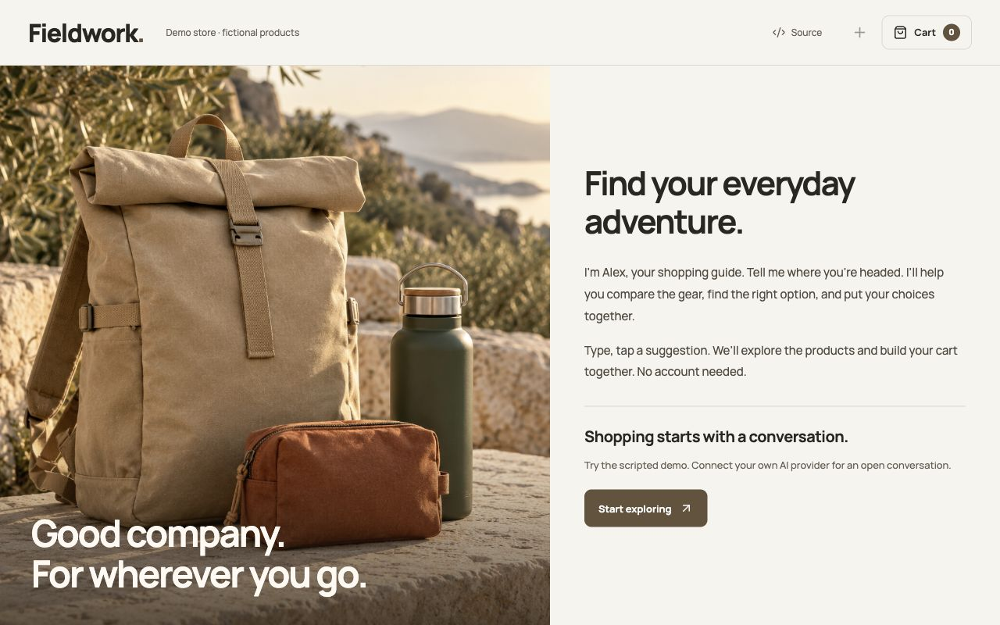
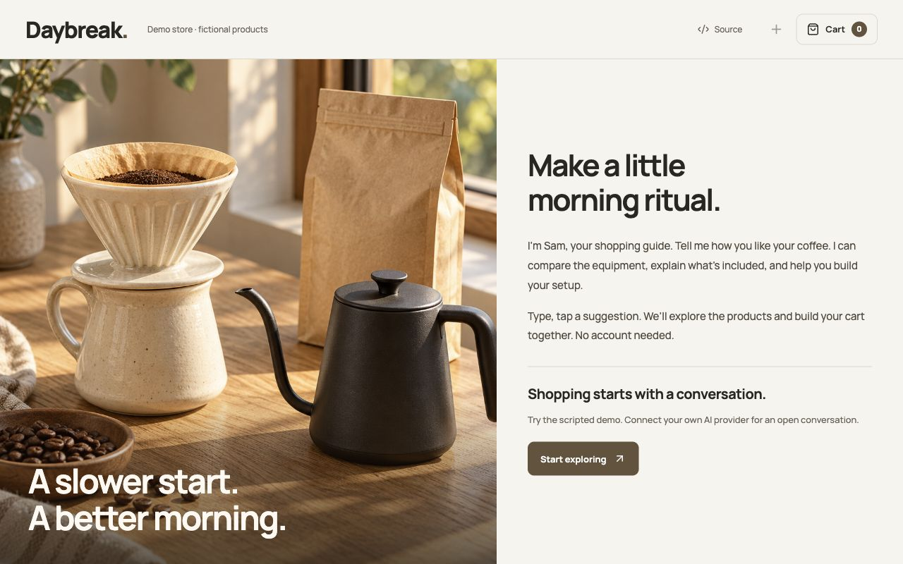

# Agentic Storefront

**A storefront you shop by having a conversation.**

Visitors type, speak, or tap suggested replies. The guide explains products, compares options, brings relevant visuals into view, and builds a cart when asked. The cart shares the visual stage with products, so it never covers the conversation.



An MIT-licensed starter for **different kinds of shops**, with two fictional merchants running the same code: **Fieldwork** (outdoor goods) and **Daybreak** (coffee equipment and beans). Neither is a real store. Merchant content lives in configuration; there are no wall-hanging or interior-design rules in the core.

## Try it locally

Use Node **24 or 26** and npm. No AI keys or Shopify account are needed for the scripted demo.

```sh
git clone https://github.com/leviseyes/agentic-storefront.git
cd agentic-storefront
npm ci
npm run dev
```

Open the localhost URL printed by Vite. The launcher applies the local D1 migration first. Try “Add two pouches”, “Show me the bottle”, “750 ml”, “Compare products”, or “Remove the pouch”. Demo checkout takes no payment.

To try a different category:

```sh
npm run dev:coffee
```



## What is reusable

- **Merchant configuration:** identity, guide, opening question, products, variants, prices, verified facts, use cases, policies, and owned visuals.
- **Shopping:** product and variant selection, side-by-side comparisons, stock states, multi-item carts, and hosted Shopify checkout.
- **Agent tools:** allowlisted collection, product, comparison, cart, policy, optional video, and optional photo-concept views. The model never supplies arbitrary HTML or executable UI.
- **Voice:** optional xAI realtime speech; optional ElevenLabs speech output with OpenAI transcription. Sound starts by choice, and speaking input requires microphone permission. No avatar or customer account is required.
- **Server authority:** explicit cart intent, quantity bounds, shared text/voice rules, persisted total targets, request deduplication, session locks, and rate limits.
- **Anonymous sessions:** private cookies and D1 state, with optional private R2 photo assets and a fresh-conversation action.

## Make it your shop

Start with either file under `examples/`. Edit products, facts and policies, then choose your configuration in `storefront.config.js`. The UI and agent tools consume the same catalog. `defineStorefront()` rejects invalid IDs, duplicate options, invalid prices, and unsafe asset sources.

```js
// storefront.config.js — replace the two demo imports when you add your merchant.
import merchant from './examples/your-shop/storefront.js';
import {defineStorefront} from './shared/storefront.js';
export const storefront = defineStorefront(merchant);
```

The examples deliberately include **different option types**: colors, capacities, and coffee preparation. Add merchant-owned images or GLB models through product `visuals`. Photo concepts are an optional merchant tool; they are off in both examples.

Connect your own provider keys in an ignored `.dev.vars` file. Set `COMMERCE_MODE=shopify` only after configuring your own product handles and variant mappings. Keys stay on the server. This project does not provision credentials or share any merchant’s secrets.

Read [configuration](docs/configuration.md), [architecture](docs/architecture.md), [deployment](docs/deployment.md), and [asset provenance](docs/assets.md).

## Scope

This is a **curated-catalog starter**, currently limited to 20 products, 100 variants per product, 20 distinct cart options, and 20 units per option. It is general across product categories, but it is not a full catalog importer, marketplace, merchant admin, or order-management system. Arbitrary natural-language cart commands outside the supported grammar ask for clarification; the model cannot override consent rules.

Shopify owns final inventory enforcement, shipping, taxes, eligible discounts, payment, and orders. Merchant facts and policies must be reviewed by the merchant. Photo concepts are illustrative; they do not establish measurements, safety, medical suitability, or product guarantees.

The default demo makes no runtime AI or Shopify requests. Provider-backed flows cost money and require your account’s model access. Before public use, review privacy disclosures, abuse limits, merchant claims, monitoring, and checkout in a development store. See [SECURITY.md](SECURITY.md).

## Development

```sh
npm test
npm run typecheck
npm run check:public
npm run build
npm run build:coffee
```

React + TypeScript + Vite, Cloudflare Workers + D1 + R2, Shopify Storefront GraphQL API **2026-10**. Tests cover both example catalogs, cart intent and retries, server privacy, media lifecycle, speech cancellation, transcript deduplication, and Shopify adapter behavior with injected responses. Provider audio and real-store checkout require your own staging checks.

Contributions that make merchant setup simpler, add useful adapters, or improve accessibility are welcome. Please read [CONTRIBUTING.md](CONTRIBUTING.md). If this is useful to you, a GitHub star helps others find it.

[MIT license](LICENSE) · [Changelog](CHANGELOG.md)
