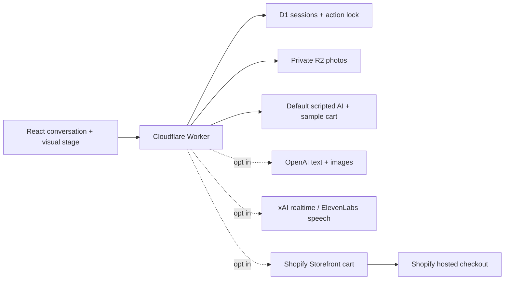

# Architecture

## Entry points

- `client/WallStudio.tsx` owns the two panels and current presentation.
- `server/bootstrap.mjs` selects demo or Shopify commerce and scripted or OpenAI responses independently.
- `server/wall-api.mjs` owns anonymous sessions, requests, uploads, action validation and checkout.
- `server/cart-intent.mjs` checks explicit shopping intent and resolves relative/total quantities.
- `server/grok-voice.mjs` constrains realtime messages and executes the same cart rules server-side.
- `client/voice/` manages audio lifecycle, interruption and late event cancellation.
- `server/wall-store.mjs` stores sessions and private object references.

React runs through Vite with a plain Cloudflare Worker. No server-rendering framework or Sites host is required. This repo is a starter with tested boundaries, not a claim of production hardening or PCI certification.

## Agent actions

Structured decisions can select an allowlisted visual, request a photo concept or propose a cart total. Arbitrary model HTML, URLs, scripts and render instructions are not accepted. Text commerce shortcuts avoid a model round trip for clear cart requests. A preview’s frame count and approval of a design are never purchase consent.

The cart supports one configured product variant and totals 0–20. Cart IDs, line keys and checkout URLs stay in server sessions. Only sanitized quantities, titles and totals are sent to the browser. Returned Shopify quantities win over model assumptions.

The local demo cart is stateless and session-referenced. It cannot reserve inventory or charge money. Live commerce is an explicit server configuration change.

## Data and controls

Anonymous HttpOnly, SameSite=Lax cookies identify browser projects; Secure is used on HTTPS. Sessions expire after seven days. API access after expiry is denied; physical cleanup is opportunistic in bounded sweeps and is not a precise seven-day deletion scheduler. Add scheduled cleanup and R2 lifecycle policies for stronger retention requirements.

Mutation endpoints verify same origin, request size and input types. Uploads check image signatures. Photos are served through session-scoped URLs. A project lock prevents overlapping mutations from applying stale data. Per-session and IP-based counters bound work; these are starter limits, not a full anti-abuse or budget enforcement system. Public AI hosting should also use provider spending limits and appropriate edge controls.

Prompts explicitly treat visitor messages and photo text as untrusted. These instructions supplement server validation; they do not make prompt injection impossible. Avoid adding privileged Admin actions to this public-facing agent.

The automated suite uses injected providers and WebSocket/audio mocks. It verifies orchestration and safety boundaries without calling paid services; it does not certify perceptual voice quality or end-to-end provider availability.
